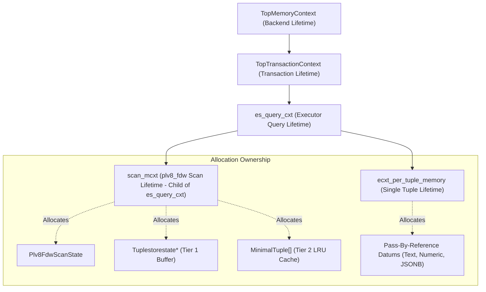

<!-- disableFinding(LINE_OVER_80) -->
<!-- disableFinding(HEADING_FUNCTION) -->

# PL/v8 Foreign Data Wrapper (`plv8_fdw`) Low-Level Design (LLD)

## 1. Introduction & Architectural Scope

This Low-Level Design (LLD) provides the comprehensive internal specification for **`plv8_fdw`**, an ANSI/ISO SQL/MED (Management of External Data) Foreign Data Wrapper integrated directly into **`pl/v8`** and the Google V8 JavaScript runtime engine.

The core `plv8_fdw` engine operates strictly within the PostgreSQL kernel and V8 isolate boundary. It avoids external networking dependencies by focusing purely on relational planning, predicate pushdown, zero-copy slot streaming, rescan memoization, and DML write delegation. Local in-memory structures (`ArrayTableFdw` and `MapTableFdw`) serve as reference implementations and hermetic test harnesses.

---

## 2. PostgreSQL SQL/MED Callback Matrix & Function Signatures

`plv8_fdw` implements the complete `FdwRoutine` interface defined in `src/include/foreign/fdwapi.h`. The SQL entry points are:

```c
PGDLLEXPORT Datum plv8_fdw_handler(PG_FUNCTION_ARGS);
PGDLLEXPORT Datum plv8_fdw_validator(PG_FUNCTION_ARGS);
```

### 2.1 Complete Callback Matrix

| Phase | Callback Function | PostgreSQL Signature | Responsibilities & V8 Boundary |
| :--- | :--- | :--- | :--- |
| **Planner** | `GetForeignRelSize` | `void (*)(PlannerInfo *root, RelOptInfo *baserel, Oid foreigntableid)` | Invokes `wrapper.getRelSize(quals, projectedCols)`; sets `baserel->rows` and `baserel->reltarget->width`. |
| **Planner** | `GetForeignPaths` | `void (*)(PlannerInfo *root, RelOptInfo *baserel, Oid foreigntableid)` | Queries `wrapper.getPathKeys()` and indexed columns; builds sequential, sorted, and parameterized inner join paths (`add_path`). |
| **Planner** | `GetForeignPlan` | `ForeignScan *(*)(PlannerInfo *root, RelOptInfo *baserel, Oid foreigntableid, ForeignPath *best_path, List *tlist, List *scan_clauses, Plan *outer_plan)` | Segregates pushdown vs. local clauses (`foreign_scan->scan.plan.qual`); packs options into `fdw_private`. |
| **Executor (Scan)** | `BeginForeignScan` | `void (*)(ForeignScanState *node, int eflags)` | Allocates `Plv8FdwScanState` in `es_query_cxt`; evaluates initial runtime parameters; invokes `wrapper.execute()`. |
| **Executor (Scan)** | `IterateForeignScan`| `TupleTableSlot *(*)(ForeignScanState *node)` | Zero-copy virtual tuple streamer (`TTSOpsVirtual`); populates values in `ecxt_per_tuple_memory`; records cache entries. |
| **Executor (Scan)** | `ReScanForeignScan` | `void (*)(ForeignScanState *node)` | Evaluates updated parameters; checks Tier 1 Tuplestore rewind or Tier 2 LRU memoizer; re-executes V8 on cache miss. |
| **Executor (Scan)** | `EndForeignScan` | `void (*)(ForeignScanState *node)` | Disposes V8 persistent handles; frees `Tuplestorestate` and LRU cache structures; unregisters memory callbacks. |
| **Planner (DML)** | `AddForeignUpdateTargets` | `void (*)(PlannerInfo *root, Index rtindex, RangeTblEntry *target_rte, Relation target_relation)` | Adds resjunk attribute for `rowidColumn` into target relation's targetlist. |
| **Planner (DML)** | `PlanForeignModify` | `List *(*)(PlannerInfo *root, ModifyTable *plan, Index resultRelation, int subplan_index)` | Generates private modify data (junk attribute mapping). |
| **Executor (DML)** | `BeginForeignModify` | `void (*)(ModifyTableState *mtstate, ResultRelInfo *rinfo, List *fdw_private, int subplan_index, int eflags)` | Allocates `Plv8FdwModifyState`; resolves junk rowid column attribute number. |
| **Executor (DML)** | `ExecForeignInsert` | `TupleTableSlot *(*)(EState *estate, ResultRelInfo *rinfo, TupleTableSlot *slot, TupleTableSlot *planSlot)` | Converts slot to JS object; invokes `wrapper.insert(row)`. |
| **Executor (DML)** | `ExecForeignBatchInsert` | `TupleTableSlot **(*)(EState *estate, ResultRelInfo *rinfo, TupleTableSlot **slots, TupleTableSlot **planSlots, int *numSlots)` | Marshals slot array to JS array; invokes `wrapper.batchInsert(rows)`. |
| **Executor (DML)** | `GetForeignModifyBatchSize` | `int (*)(ResultRelInfo *rinfo)` | Queries `wrapper.batchSize` (default 1). |
| **Executor (DML)** | `ExecForeignUpdate` | `TupleTableSlot *(*)(EState *estate, ResultRelInfo *rinfo, TupleTableSlot *slot, TupleTableSlot *planSlot)` | Extracts junk `rowid` from `planSlot`; dispatches `wrapper.update(rowid, newValues)`. |
| **Executor (DML)** | `ExecForeignDelete` | `TupleTableSlot *(*)(EState *estate, ResultRelInfo *rinfo, TupleTableSlot *slot, TupleTableSlot *planSlot)` | Extracts junk `rowid` from `planSlot`; dispatches `wrapper.delete(rowid)`. |
| **Executor (DML)** | `EndForeignModify` | `void (*)(EState *estate, ResultRelInfo *rinfo)` | Cleans up modify state; disposes handles. |
| **Direct Modify** | `PlanDirectModify` | `bool (*)(PlannerInfo *root, ModifyTable *plan, Index resultRelation, int subplan_index)` | Evaluates if bulk modification can be pushed down directly. |
| **Direct Modify** | `BeginDirectModify` | `void (*)(ForeignScanState *node, int eflags)` | Initializes direct modify state. |
| **Direct Modify** | `IterateDirectModify` | `TupleTableSlot *(*)(ForeignScanState *node)` | Dispatches `wrapper.directModify(operation, quals, newValues)`. |
| **Direct Modify** | `EndDirectModify` | `void (*)(ForeignScanState *node)` | Tears down direct modify state. |
| **Optimizer Info** | `ExplainForeignScan` | `void (*)(ForeignScanState *node, struct ExplainState *es)` | Appends pushdown quals, cache hit counts, and wrapper stats to `EXPLAIN`. |
| **Optimizer Info** | `AnalyzeForeignTable` | `bool (*)(Relation relation, AcquireSampleRowsFunc *func, BlockNumber *totalpages)` | Sets `AcquireSampleRowsFunc` and samples rows from `wrapper.acquireSample()`. |
| **Schema Discovery**| `ImportForeignSchema` | `List *(*)(ImportForeignSchemaStmt *stmt, Oid serverOid)` | Generates `CREATE FOREIGN TABLE` statements from `wrapper.importForeignSchema()`. |
| **Capabilities** | `IsForeignRelUpdatable` | `int (*)(Relation rel)` | Returns bitmask `(1 << CMD_INSERT) | (1 << CMD_UPDATE) | (1 << CMD_DELETE)`. |

---

## 3. C++ Class & Struct Layouts

### 3.1 Predicate Qual Representation (`Plv8Qual`)

During planning and runtime execution, SQL expressions are translated into `Plv8Qual` instances:

```cpp
enum class Plv8QualType {
  SIMPLE_OP,      // Binary comparison (col = const, col > const, etc.)
  ARRAY_OP,       // ScalarArrayOpExpr (col = ANY(ARRAY[...])) -> 'IN'
  NULL_TEST       // NullTest (col IS NULL / col IS NOT NULL)
};

struct Plv8Qual {
  Plv8QualType type;
  std::string field;              // Attribute name
  AttrNumber varattno;            // 1-based table attribute number
  std::string op;                 // '=', '<', '>', '<=', '>=', '<>', 'LIKE', 'IN', 'IS'
  Oid opno;                       // PostgreSQL operator OID
  Node *left_expr;                // Raw left node (for parameter evaluation)
  Node *right_expr;               // Raw right node (for parameter evaluation)
  bool is_param;                  // True if value depends on PARAM_EXEC / PARAM_EXTERN
  bool is_null_test;              // True for IS NULL / IS NOT NULL
  bool null_test_is_not_null;     // False for IS NULL, True for IS NOT NULL
  v8::Global<v8::Value> const_val;// Resolved constant (if non-parameterized)
};
```

### 3.2 Rescan Tuple Cache Entry (`Plv8ParamCacheEntry`)

For parameterized rescans, each unique set of parameter values is memoized:

```cpp
struct Plv8ParamCacheEntry {
  uint64 param_hash;                      // FNV-1a / 64-bit parameter signature
  std::vector<MinimalTuple> tuples;       // Materialized MinimalTuples in scan_mcxt
  size_t memory_used;                     // Total bytes allocated for tuples in entry
};
```

### 3.3 Foreign Scan Execution State (`Plv8FdwScanState`)

Allocated in `node->ss.ps.state->es_query_cxt` during `BeginForeignScan`:

```cpp
struct Plv8FdwScanState {
  // V8 Context & Execution handles
  v8::Isolate* isolate;
  v8::Global<v8::Context> context;
  v8::Global<v8::Object> wrapper_instance;
  v8::Global<v8::Object> iterator;
  v8::Global<v8::Function> next_fn;

  // Relation & Column Schema
  TupleDesc tupdesc;
  std::vector<plv8_type> coltypes;
  std::vector<std::string> colname_strs;
  std::vector<v8::Global<v8::String>> colnames;
  std::vector<AttrNumber> projected_attrs;
  std::vector<Plv8Qual> pushed_quals;
  List* fdw_clauses;

  // Memory Contexts & Lifetimes
  MemoryContext scan_mcxt;                // Child of es_query_cxt
  MemoryContextCallback cleanup_cb;       // Registered cleanup hook
  bool eof_reached;

  // Caching Subsystem (Section 5)
  bool cache_enabled;
  size_t cache_size_limit;                // Max parameter cache entries (default 1000)
  size_t cache_memory_limit_bytes;        // Max bytes for cached tuples (default 16MB)
  size_t current_cache_bytes;

  // Tier 1: Unparameterized rewindable Tuplestore
  bool is_parameterized;
  Tuplestorestate* unparam_tuplestore;
  bool unparam_cache_complete;

  // Tier 2: Parameterized LRU memoizer
  std::unordered_map<uint64, Plv8ParamCacheEntry> param_cache;
  std::list<uint64> param_lru_order;
  uint64 current_param_hash;
  bool replaying_from_cache;
  size_t cached_tuple_cursor;

  // EXPLAIN Metrics
  uint64 stats_rows_fetched;
  uint64 stats_cache_hits;
  uint64 stats_cache_misses;
};
```

### 3.4 Foreign Modify State (`Plv8FdwModifyState`)

```cpp
struct Plv8FdwModifyState {
  v8::Isolate* isolate;
  v8::Global<v8::Context> context;
  v8::Global<v8::Object> wrapper_instance;
  CmdType operation;
  TupleDesc tupdesc;
  std::vector<plv8_type> coltypes;
  std::vector<std::string> colname_strs;
  std::vector<v8::Global<v8::String>> colnames;
  AttrNumber rowid_attno;                 // Resjunk rowid attribute in planSlot
  std::string rowid_colname;
  int batch_size;
  std::vector<v8::Global<v8::Object>> batch_rows;
};
```

---

## 4. Memory Context Lifecycles & Virtual Tuple Streaming

### 4.1 Memory Context Hierarchy



### 4.2 Zero-Copy Virtual Slot Streaming (`TTSOpsVirtual`)

1. PostgreSQL's executor sets `CurrentMemoryContext` to `econtext->ecxt_per_tuple_memory` immediately before calling `IterateForeignScan`.
2. `IterateForeignScan` obtains the next JavaScript record by invoking `iterator.next()`.
3. For each non-null attribute requested in `projected_attrs`:
   - Property value is extracted: `v8::Local<v8::Value> prop_val = row_obj->Get(context, colnames[i])`.
   - Converted to PostgreSQL Datum via `ToDatum(prop_val, &isnull, &coltypes[i])`.
   - Because `CurrentMemoryContext` is `ecxt_per_tuple_memory`, all variable-length data (e.g. `varlena`, `text`, `bytea`, `jsonb`) is allocated directly in the per-tuple context.
   - Pointer is written to `slot->tts_values[i]` and `slot->tts_isnull[i] = false`.
4. `ExecStoreVirtualTuple(slot)` marks the slot valid without copying or creating physical `HeapTuple` headers.
5. Once upper plan nodes consume the tuple, the executor calls `ResetExprContext()`, instantaneously freeing `ecxt_per_tuple_memory`.

---

## 5. Rescan & Parameter Tuple Caching Engine

### 5.1 Tier 1: Unparameterized Rewindable Tuplestore

When `is_parameterized == false`:
1. On initial scan, tuples emitted from V8 are recorded into `unparam_tuplestore` using `tuplestore_puttupleslot(festate->unparam_tuplestore, slot)`.
2. When V8 iterator returns `{done: true}`, `unparam_cache_complete = true`.
3. On `ReScanForeignScan`, `tuplestore_rescan(festate->unparam_tuplestore)` is called.
4. Subsequent calls to `IterateForeignScan` call `tuplestore_gettupleslot()`, completely skipping V8 handle creation and JavaScript execution.

### 5.2 Tier 2: Parameterized LRU Memoizer

When `is_parameterized == true`:
1. On each `ReScanForeignScan`:
   - Parameter expressions (`PARAM_EXEC`) are evaluated against `node->ss.ps.ps_ExprContext` using `ExecEvalExpr()`.
   - A 64-bit parameter hash is computed using FNV-1a:
     ```cpp
     uint64 hash = 14695981039346656037ULL;
     for (const auto& qual : quals) {
       hash ^= (uint64) qual.varattno;
       hash *= 1099511628211ULL;
       // Hash Datum bytes & isnull flag
     }
     ```
2. **Cache Probe**:
   - If `param_cache.find(hash)` hits:
     - Entry moved to front of `param_lru_order`.
     - `replaying_from_cache = true; cached_tuple_cursor = 0;`
     - `stats_cache_hits++`.
   - If miss:
     - `replaying_from_cache = false;`
     - Evaluates `wrapper.execute(newQuals)`.
     - Emitted virtual slots are converted to `MinimalTuple` via `ExecCopySlotMinimalTuple(slot)` and appended to the current entry.
     - `stats_cache_misses++`.
3. **LRU Eviction**:
   - If `param_cache.size() > cache_size_limit` or `current_cache_bytes > cache_memory_limit_bytes`:
     - Oldest entry in `param_lru_order` is popped.
     - All `MinimalTuple` pointers in that entry are `pfree()`'d.
     - Map entry erased.

---

## 6. Exception Handling & V8 Boundary RAII Guards

To protect against `siglongjmp` corruption and C++ `std::terminate()` aborts:

```cpp
class Plv8FdwScopeGuard {
 private:
  v8::Isolate* isolate;
  bool active;
 public:
  explicit Plv8FdwScopeGuard(v8::Isolate* iso) : isolate(iso), active(true) {}
  ~Plv8FdwScopeGuard() {
    if (active && isolate) {
      // Unwind scopes safely
    }
  }
  void dismiss() { active = false; }
};
```

All 24 `FdwRoutine` callbacks are enclosed in the standard exception boundary:

```cpp
try {
  // V8 Execution
}
catch (js_error& e) {
  e.rethrow();
}
catch (pg_error& e) {
  e.rethrow();
}
catch (const std::exception& e) {
  ereport(ERROR,
          (errcode(ERRCODE_EXTERNAL_ROUTINE_EXCEPTION),
           errmsg("plv8_fdw exception: %s", e.what())));
}
```

---

## 7. SQL DDL & Validator Specifications

### 7.1 Extension SQL DDL

```sql
CREATE FUNCTION plv8_fdw_handler()
RETURNS fdw_handler
AS 'MODULE_PATHNAME', 'plv8_fdw_handler'
LANGUAGE C STRICT;

CREATE FUNCTION plv8_fdw_validator(text[], oid)
RETURNS void
AS 'MODULE_PATHNAME', 'plv8_fdw_validator'
LANGUAGE C STRICT;

CREATE FOREIGN DATA WRAPPER plv8_fdw
  HANDLER plv8_fdw_handler
  VALIDATOR plv8_fdw_validator;
```

### 7.2 Option Validation Table

| Context | Option Name | Valid Values | Default | Purpose |
| :--- | :--- | :--- | :--- | :--- |
| `SERVER` / `TABLE` | `wrapper` | String (Identifier / Path) | None | Class name of the `plv8.ForeignDataWrapper` implementation |
| `SERVER` / `TABLE` | `cache_results` | `'true'`, `'false'`, `'on'`, `'off'` | `'true'` | Enables Tier 1 / Tier 2 rescan caching |
| `SERVER` / `TABLE` | `cache_size` | Integer (1..100000) | `1000` | Maximum number of parameter entries in LRU memoizer |
| `SERVER` / `TABLE` | `cache_memory_limit` | String / Integer (`'1MB'`, `'16MB'`) | `16MB` | Memory ceiling for cached tuples before fallback |
| `TABLE` | `rowid_column` | Column name | None | Primary key column name for UPDATE/DELETE |
| `SERVER` / `TABLE` | `batch_size` | Integer (1..10000) | `1` | Batch size for multi-row INSERTs |
